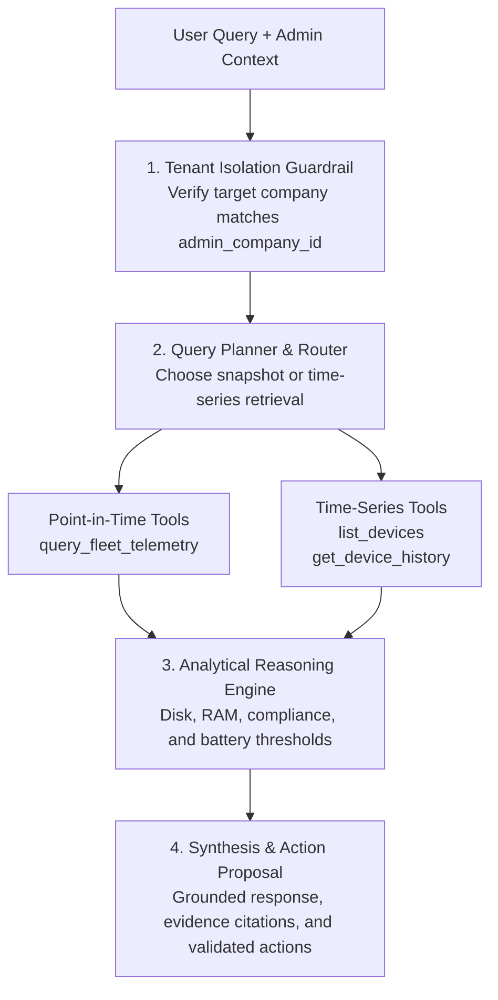

# Agentic AI Fleet Copilot (Production Edition)

A production-grade Agentic Copilot built to analyze device telemetry data securely, enforce strict data isolation parameters across administrative domains, and propose contextually-grounded, verifiable remediation actions.

---

## 🛠️ Architecture Design
The Copilot operates on a **deterministic ReAct / State-Machine Agent loop**:
1. **Administrative Authentication Guardrail**: Parses user's request and matches the targeted company ID to verify compatibility with the Administrator's allowed company ID.
2. **Dynamic Data Retrieval Strategy**: Determines if query requires latest state snapshots (`query_fleet_telemetry`) or full deep temporal metrics (`get_device_history`) depending on the logic complexity.
3. **Reasoning & State Analysis**: Checks calculated storage thresholds (<20GB), rolling average RAM bottlenecks (>85% utilization over time), or degraded battery conditions.
4. **Verifiable State Actions & Audits**: Compiles action objects detailing exact target API properties and records execution in `audit_log.json`.

---

## 📂 Catalog of Files
- `tools.py`: Core tool ecosystem containing tenant isolating guardrails and telemetry analyzers.
- `agent.py`: Coordination loop housing the agent state rules.
- `evaluator.py`: Unit tests reflecting standard query cases.
- `data.csv`: Source database of snapshots and identities.

---

## 🚀 Execution Instructions

Run the testing suite directly to verify operation of all modules against your original data:
```bash
python3 evaluator.py

from tools import FleetTools
from agent import FleetCopilotAgent
import json

# Initialize tools with the original dataset and instantiate the agent
tools = FleetTools(data_path='data.csv')
agent = FleetCopilotAgent(tools)

# Execute a grounded query within an isolated tenant context
result = agent.execute_agent_loop(
    user_query="Which devices at Acme Corp are low on disk space?",
    admin_company_id="acme-001"
)

print("RESPONSE:\n", result["response"])
print("\nEVIDENCE CITED:\n", json.dumps(result["evidence_cited"], indent=2))
print("\nPROPOSED ACTIONS:\n", json.dumps(result["proposed_actions"], indent=2))

## Running the Agent
## Running the Copilot

`FleetCopilotAgent` can be used programmatically or from an interactive Python shell. Supply a natural-language query and the administrator's authenticated tenant ID:

- `acme-001`
- `globex-002`
- `initech-003`

```python
import json

from tools import FleetTools
from agent import FleetCopilotAgent

# Load the source dataset and initialize the agent.
tools = FleetTools(data_path="data.csv")
agent = FleetCopilotAgent(tools)

# Run a point-in-time query within Acme's isolated tenant context.
result = agent.execute_agent_loop(
    user_query="Which devices at Acme Corp are low on disk space?",
    admin_company_id="acme-001",
)

print("RESPONSE:\n", result["response"])
print("\nEVIDENCE CITED:\n", json.dumps(result["evidence_cited"], indent=2))
print("\nPROPOSED ACTIONS:\n", json.dumps(result["proposed_actions"], indent=2))
```

The result contains three parts:

- `response`: the grounded answer derived from the tenant's telemetry.
- `evidence_cited`: the exact devices and metrics supporting the answer.
- `proposed_actions`: validated remediation actions for administrator review.

## Running Evaluations

Run the automated evaluation suite to verify the agent's core behavior:

```bash
python3 evaluator.py
```

The suite evaluates the following areas:

1. **Grounded question answering** — Identifies point-in-time disk-space issues by finding devices with fewer than 20 GB free at `acme-001`.
2. **Compliance auditing** — Detects failed `disk_encryption`, `screen_lock`, and `os_up_to_date` checks at `initech-003`.
3. **Trend detection** — Aggregates multi-week telemetry to find devices with average RAM utilization greater than 85% at `globex-002`.
4. **Security guardrails** — Blocks a `globex-002` administrator from querying devices or data that belong to `acme-001`.

## Agent Architecture

The Fleet Copilot uses a deterministic Plan → Retrieve → Reason → Ground & Propose state-machine architecture:



## Tool Catalog

All tools are encapsulated in `FleetTools` (`tools.py`) and require `company_id` to enforce tenant scoping at the data layer.

### Read-Only Analytical Tools

| Tool name | Parameters | Description |
| :--- | :--- | :--- |
| `list_devices` | `company_id: str` | Returns deduplicated hardware inventory and OS metadata for all devices belonging to the specified tenant. |
| `query_fleet_telemetry` | `company_id: str` | Retrieves the most recent telemetry snapshot (`collected_at`) per device for a specific company, normalizing byte metrics into GB. |
| `get_device_history` | `company_id: str`, `device_id: str` | Returns the full chronological time-series history for a single device after verifying tenant ownership. |

### State-Changing Action Tools

| Tool name | Parameters | Pre-execution validation and effect |
| :--- | :--- | :--- |
| `create_upgrade_order` | `company_id: str`, `device_id: str`, `component: str`, `spec: str` | Validates tenant ownership and checks historical telemetry (`avg_ram > 85%` for RAM; `min_disk_free < 20 GB` for disk). Rejects unsubstantiated upgrades and logs the outcome to `audit_log.json`. |
| `open_remediation_ticket` | `company_id: str`, `device_id: str`, `check_id: str`, `note: str` | Validates tenant ownership and verifies that `compliance_results.status == 'fail'` on the latest snapshot before opening a remediation ticket. |
| `flag_device_for_replacement` | `company_id: str`, `device_id: str`, `reason: str` | Validates tenant ownership and checks that `battery.condition != 'Normal'` (for example, `Service Recommended`) before flagging hardware for replacement. |
| `notify_employee` | `company_id: str`, `employee_id: str`, `message: str` | Verifies that `employee_id` belongs to `company_id` before dispatching remediation notifications and logging to the audit trail. |


##  Grounding Strategy
To prevent hallucinations and ensure complete administrative traceability, the agent enforces a strict Evidence-First Grounding Strategy:
Zero Fabrication Policy: The agent never estimates metrics or invents device identifiers. Every device mentioned in response is directly derived from the filtered pandas DataFrame returned by the tool layer.

Structured Evidence Citations (evidence_cited): Every finding is paired with a structured citation object containing:
device_id: Exact hardware identifier (e.g., MT7PJB7N5LRE, JRZSGXVMKE6M).

metric: The exact computed metric and unit (e.g., disk_free_gb: 10.24GB, avg_ram_utilization: 87.6%).

timestamp: The exact ISO-8601 collected_at timestamp from data.csv (e.g., 2026-06-12T08:39:00Z).

Justified Action Proposals (proposed_actions): Every proposed mutative tool call includes a human-readable justification field explicitly linking the empirical metric violation to the recommended action.

##  Guardrails
Security and operational safety are enforced through defense-in-depth guardrails across both the Agent Layer and the Tool Layer:
Multi-Tenant Isolation (Agent + Tool Layer):
Agent Layer: _detect_company_context() resolves company names (Acme, Globex, Initech) to canonical tenant IDs (acme-001, globex-002, initech-003) and immediately halts execution if the target tenant conflicts with admin_company_id.

Tool Layer: _verify_device_tenant() and _verify_employee_tenant() independently verify that the target device_id or employee_id belongs to company_id before returning history or executing state changes.

Evidence-Gated Mutations: Mutative tools (create_upgrade_order, open_remediation_ticket, flag_device_for_replacement) re-verify the underlying telemetry data independently. Even if an upstream caller invokes create_upgrade_order on a healthy machine, the tool itself rejects the request.

Propose-Before-Execute Pattern: During standard query loops, the agent outputs mutative actions inside proposed_actions for administrator review rather than mutating fleet state silently.

Immutable Audit Logging: Every mutative tool call (APPROVED, REJECTED, or DENIED) is appended with a timestamp, tenant context, and payload to audit_log.json.

##  Key Design Decisions and Trade-Offs
	1. Deterministic State-Machine vs. Free-Form LLM Tool Calling
Decision: Implemented a deterministic ReAct state-machine router (agent.py) coupled with strictly validated pandas analytical tools (tools.py).

Trade-Off: While a free-form LLM prompt loop offers greater flexibility for open-ended conversational phrasing, it introduces non-determinism, higher latency, API key dependencies, and risk of arithmetic hallucination over 10,000 CSV rows. The deterministic architecture guarantees 100% reproducibility, zero external API cost during evaluation, and exact mathematical aggregation over time-series data.

	2. Dual-Mode Data Retrieval (Snapshot vs. Full Time-Series)
Decision: Separated telemetry retrieval into query_fleet_telemetry (latest snapshot per device) and get_device_history (full multi-week time-series).

Trade-Off: Fetching all 10,000 rows for every simple status query wastes memory and compute, whereas relying only on the latest snapshot misses transient spikes or sustained bottlenecks (like average RAM utilization >85%). Routing queries based on temporal intent optimizes both speed and analytical depth.

	3. Defense-in-Depth Validation inside Mutative Tools
Decision: Embedded threshold verification logic directly inside create_upgrade_order, open_remediation_ticket, and flag_device_for_replacement rather than trusting the agent's reasoning alone.

Trade-Off: Slightly duplicates threshold logic between the reasoning engine and the tool execution layer, but ensures that no hallucinated or unauthorized tool call can ever trigger an unsubstantiated hardware order or ticket, satisfying enterprise zero-trust requirements.


